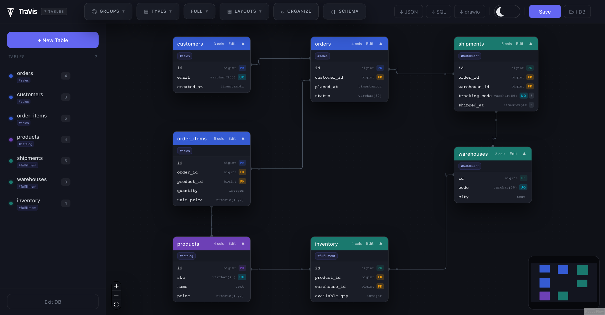
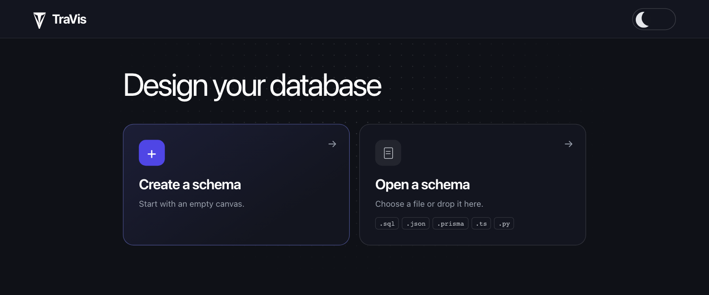
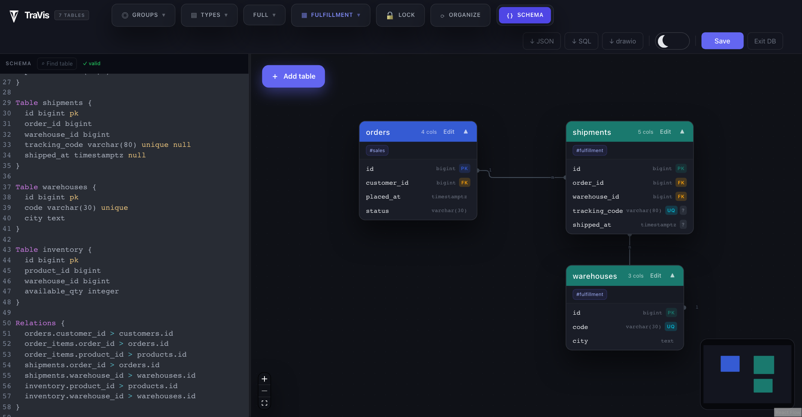

# TraVis

[Open TraVis in your browser](https://travis-db.vercel.app/)

TraVis is a browser-based editor for relational database schemas. It supports designing a model from scratch and inspecting an existing schema before changing it or writing queries. The diagram shows each table's columns and keys, with lines representing foreign-key relationships.



## Run locally

Use Node.js 22 or later with npm.

```sh
git clone https://github.com/uplay1007/travis.git
cd travis
npm ci
npm run dev
```

Open the local address printed by Vite. Run `npm run build` to type-check the project and generate the static site in `dist/`.

## Start a project

Choose **Create a schema** to start with an empty canvas, then use **New Table** to define the first table. Choose **Open a schema** to browse for a file or drop it onto the card. TraVis arranges the imported tables automatically when the file has no saved positions.



## Explore and edit a schema

Click a table to highlight its direct foreign-key neighbours. Hover over a relationship to see the two columns that participate in it. Use **Organize** to run the automatic layout again after changes, or drag cards into place manually.

Choose **Full** to see every column, **Compact** to show primary and foreign keys, or **Collapsed** to work at the table level. **Groups** and **Types** filter the canvas by tag and table role. A named layout can show a subset of the schema and keep its own positions and detail level. For example, a fulfillment layout can include orders, shipments and warehouses while the full model stays available under **All tables**.

Use the table form to edit columns, keys and relationships. The **Schema** button opens a text editor alongside the canvas. It uses a schema DSL with separate blocks for tables, relationships and layout positions. Valid edits update the diagram. The editor marks errors while the canvas continues to show the last valid model.



<details>
<summary>Example schema in the DSL</summary>

Paste this into **Schema** in a new project to create two tables and a foreign key from `orders.customer_id` to `customers.id`.

```text
Table customers {
  id bigint pk
  email varchar(255) unique
}

Table orders {
  id bigint pk
  customer_id bigint
  total numeric(12,2)
}

Relations {
  orders.customer_id > customers.id
}
```

</details>

## File formats

- **SQL (`.sql`)** imports common PostgreSQL and MySQL table definitions. It reads foreign keys declared in `CREATE TABLE` or added with `ALTER TABLE`. SQL export generates PostgreSQL-oriented DDL from the schema model.
- **TraVis JSON (`.json`)** supports import and export. It carries table definitions, relationships, groups and saved layouts.
- **Prisma (`.prisma`), TypeORM (`.ts`), Django and SQLAlchemy (`.py`)** support import from model files.
- **draw.io (`.drawio`)** exports an editable diagram. The file contains an overview page and one page per named layout.

## Local storage

TraVis restores the current session from browser storage. **Save** adds or updates a named entry under **Recent projects** in the same browser. Export the project as TraVis JSON to keep a file copy or move it to another browser.

## Implementation

The application is built with React, TypeScript and Vite. React Flow renders the canvas, ELK calculates automatic table positions, and CodeMirror provides the DSL editor. Parsing, editing and export run in the browser.

## Author and credits

TraVis was created and is maintained by [Ilya Levashov](https://github.com/uplay1007). [drawDB](https://github.com/drawdb-io/drawdb) was an inspiration for the schema editor.

The theme switch is adapted from work by Madflows on Uiverse. See the [third-party notices](THIRD_PARTY_NOTICES.md).
